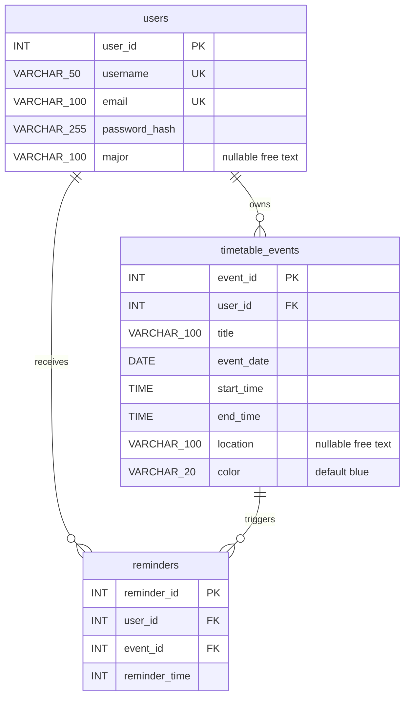

# Database schema (Sprint 6)

All new tables use `utf8mb4 / utf8mb4_unicode_ci`. Migrated utf8mb4 tables retain
existing collations. Dates/times remain typed SQL values; no localized strings or
translation columns are stored. This is the maintained ER diagram; the old PNG is
an earlier snapshot.

All three foreign keys use ON DELETE CASCADE. Text lengths, nullability, keys and
relationships are unchanged by localization.
